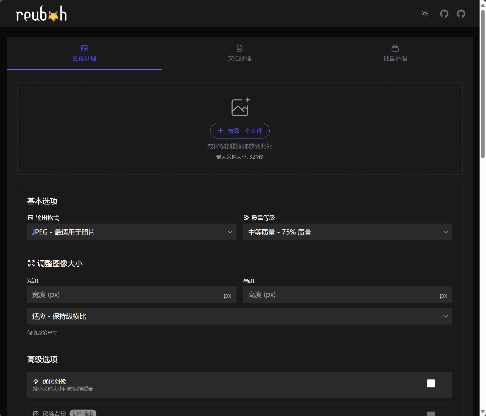
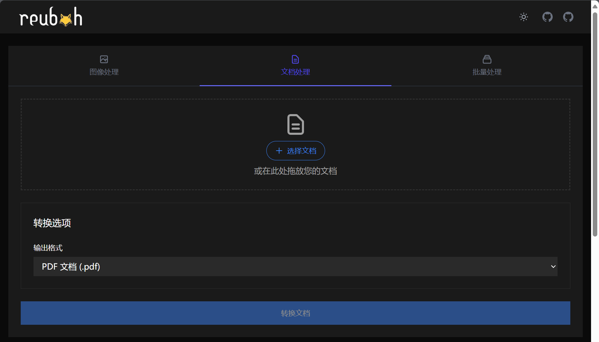
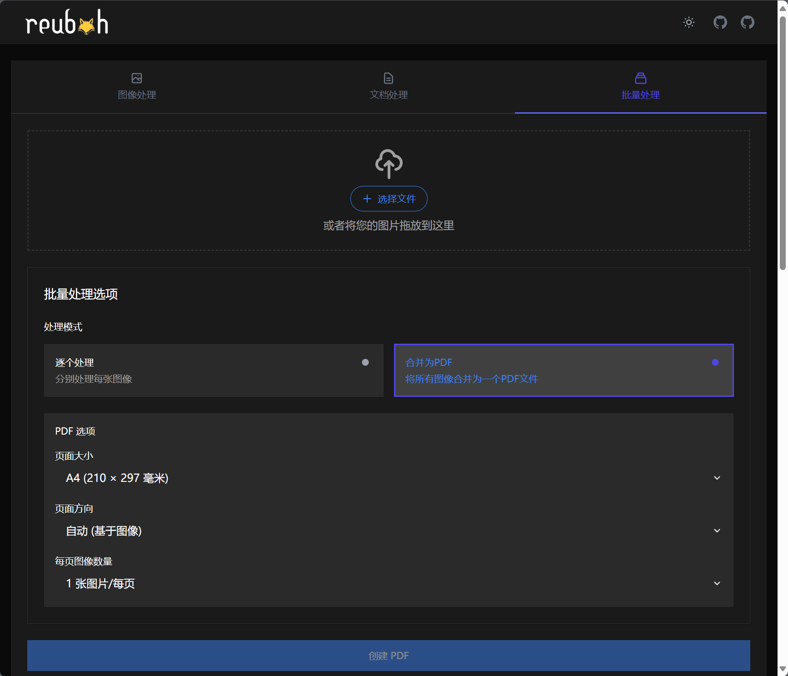
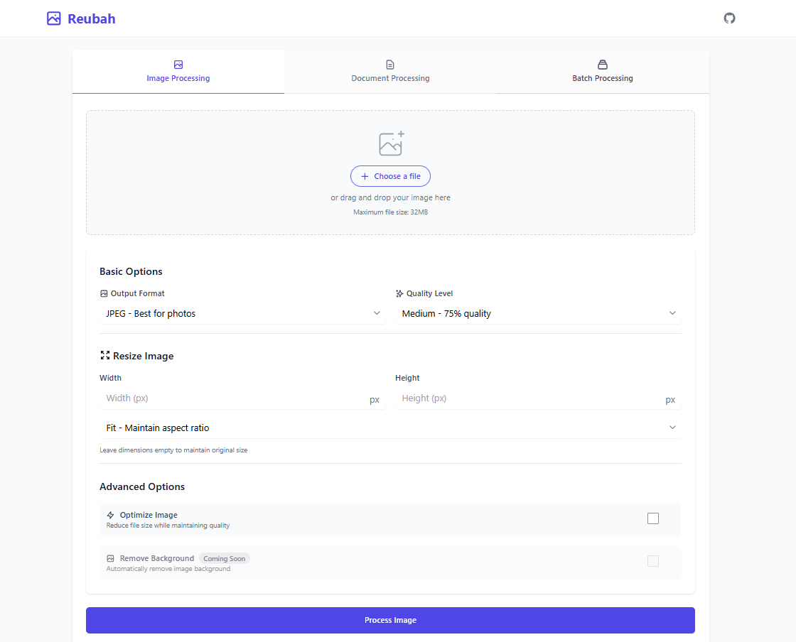
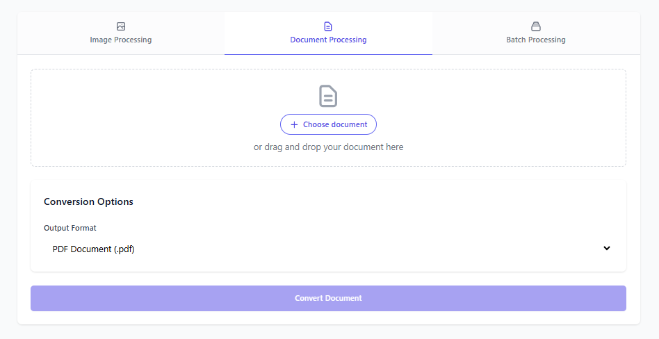
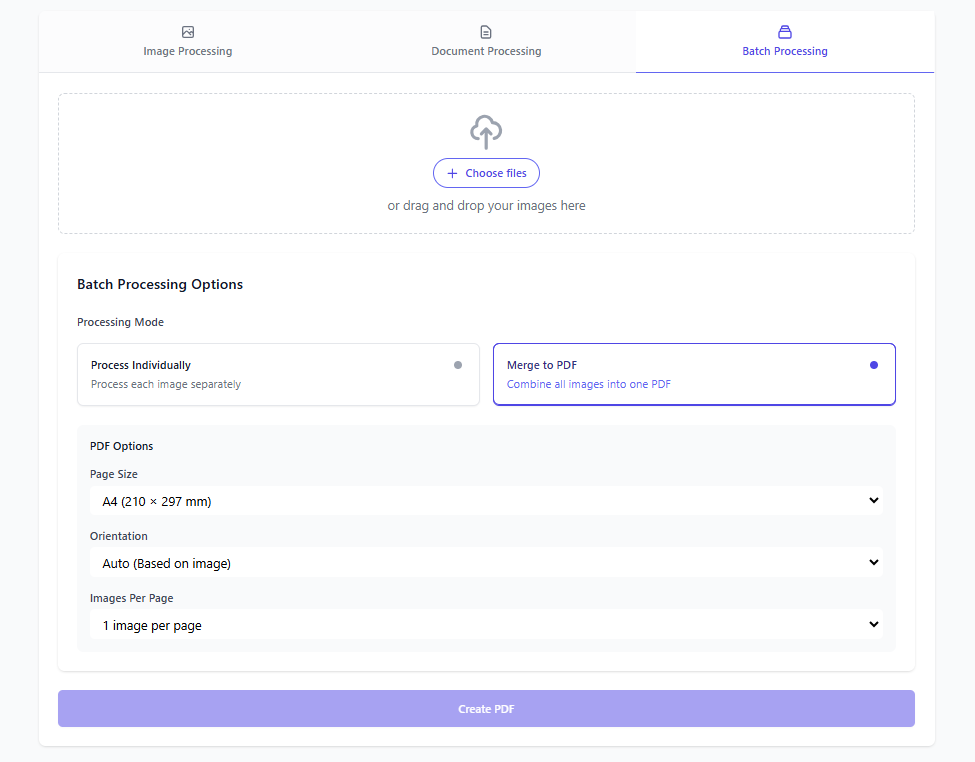

# Reubah - Universal File Converter & Image Processor 全能文件转换器 & 图像处理器

a simple web-based tool for processing images and converting documents with a simple interface  
一个简单易用的基于网页的工具，用于处理图像和转换文档，配有简洁的界面。

## Features 功能

- [x] File Converter (Keep on adding more formats)  
  文件转换器（持续新增更多格式）
- [x] Dark Mode  
  深色模式 / 暗黑模式
- [ ] API
- [ ] Background Removal for Images  
  图像背景去除 / 图片去背景功能

## 部署说明

当前汉化仅适用于 2025.06.11 之前的更新：

首先感谢原作者的开源。[原项目地址](https://github.com/dendianugerah/reubah)

具体汉化了那些内容，请参考[翻译说明](./翻译说明.md)。

只做了汉化和简单修改，有问题，请到原作者仓库处反馈。

有需要帮忙部署这个项目的朋友,一杯奶茶,即可程远程帮你部署，需要可联系。  
微信号 `E-0_0-`  
闲鱼搜索用户 `明月人间`  
或者邮箱 `firfe163@163.com`  
如果这个项目有帮到你。欢迎start。

有其他的项目的汉化需求，欢迎提issue。或其他方式联系通知。

### 镜像

从阿里云或华为云镜像仓库拉取镜像，注意填写镜像标签，镜像仓库中没有`latest`标签

容器内部端口 8081，可通过环境变量 `PORT` 自定义端口，需要将容器的缓存目录`/tmp`映射出来

```bash
swr.cn-north-4.myhuaweicloud.com/firfe/reubah:2025.06.11
```

### docker run 命令部署

```bash
docker run -d \
--name reubah \
--network bridge \
--restart always \
--log-opt max-size=1m \
--log-opt max-file=1 \
-v ./doc-temp:/tmp -p 3000:8081 \
swr.cn-north-4.myhuaweicloud.com/firfe/reubah:2025.06.11
```
### compose 文件部署 👍推荐

```yaml
#version: '3.9'
services:
  reubah:
    container_name: reubah
    image: swr.cn-north-4.myhuaweicloud.com/firfe/reubah:2025.06.11
    network_mode: bridge
    restart: always
    logging:
      options:
        max-size: 1m
        max-file: '1'
    ports:
      - 3000:8081
    volumes:
      - ./doc-temp:/tmp
```

## 修改说明

这里对除了汉化之外的代码修改的说明。  
增加修改部分具体见 [修改说明](./修改说明.md)。

`./README.md` 文件翻译，增加 `## 部署说明`、`## 修改说明`、`## 效果截图` 部分。

增加目录 `./图片` `./remote_files`(引用的远程文件)
新增文件 `./.dockerignore`、`./Dockerfile`、`./翻译说明.md`、`./修改说明.md`、`./本地调试命令记录.md` 

## 效果截图


| 图像处理 | 文档处理 | 批量处理 |
|:-:|:-:|:-:|
|  |  |  |

## Quick Start 快速开始

### Using Docker 使用 Docker
```bash
git clone https://github.com/dendianugerah/reubah.git
cd reubah
docker-compose up -d
```
or create a folder for the project and run  
或为项目创建一个文件夹并运行
```bash
docker run -d --name reubah -p 8081:8081 \
  -v doc-temp:/tmp -e PORT=8081 \
  --restart unless-stopped ghcr.io/dendianugerah/reubah:latest
```
Access at 浏览器打开: `http://localhost:8081`

### Local Development 本地开发
Requirements 要求:
- Go 1.22+
- LibreOffice (for document conversion 文档转换的要求)
- GCC/G++

```bash
go mod download
go run cmd/server/main.go
```

## Images 效果图

Here are some images related to the project:  
以下是与项目相关的一些图像





## Format Support & Compatibility 格式转换矩阵

> **Matrix Guide 矩阵指南:**
> - Find your source format in the left column  
    在左列中找到您的源格式
> - Follow the row to find available output formats  
    沿行查找可用的输出格式
> - ✅ = Supported conversion 支持的转换
> - `-` = Same format (no conversion needed) 

### Image Conversion Matrix 图像转换矩阵

| From ➡️ To ⬇️ | JPG/JPEG | PNG | WebP | GIF | BMP | HEIC/HEIF | PDF |
|--------------|:---:|:---:|:----:|:---:|:---:|:---:| :---: |
| **JPG/JPEG** | -   | ✅  | ✅   | ✅  | ✅ | ❌ | ✅   |
| **PNG**      | ✅  | -   | ✅   | ✅  | ✅  | ❌ | ✅  |
| **WebP**     | ✅  | ✅  | -    | ✅  | ✅  | ❌ | ✅  |
| **GIF**      | ✅  | ✅  | ✅   | -   | ✅  | ❌ | ✅  |
| **BMP**      | ✅  | ✅  | ✅   | ✅  | -   | ❌| ✅   |
| **HEIC/HEIF**| ✅  | ✅  | ✅   | ✅  | ✅  | - | ✅   |

### Document Conversion Matrix 文档转换矩阵

| From ➡️ To ⬇️ | PDF | DOCX | DOC | ODT | RTF | TXT |
|--------------|:---:|:----:|:---:|:---:|:---:|:---:|
| **PDF**<br>(from PDF currently still bad<br>从 PDF 当前转换效果仍不佳)     | -   | ✅   | ✅  | ❌  | ❌  | ❌  |
| **DOCX**     | ✅  | -    | ✅  | ✅  | ✅  | ✅  |
| **DOC**      | ✅  | ✅   | -   | ✅  | ✅  | ✅  |
| **ODT**      | ✅  | ✅   | ✅  | -   | ✅  | ✅  |
| **RTF**      | ✅  | ✅   | ✅  | ✅  | -   | ✅  |
| **TXT**      | ✅  | ✅   | ✅  | ✅  | ✅  | -   |

### Additional Image Features 额外的图像功能

| Format | Background Removal (Soon) | Optimization | Batch Processing |
|--------|:-----------------:|:------------:|:---------------:|
| 格式 | 背景移除 (即将推出) | 优化 | 批量处理 |
| JPG/JPEG | ❌              | ✅           | ✅              |
| PNG    | ❌                | ❌           | ✅              |
| WebP   | ❌                | ❌           | ✅              |
| GIF    | ❌                | ❌           | ✅              |
| BMP    | ❌                | ❌           | ✅              |
| HEIC/HEIF | ❌             | ❌           | ✅              |

## Notes 注意事项

- Isolated processing environment  
  隔离的处理环境：每个文件在独立的环境中进行处理，确保安全性和稳定性。
- No file storage - immediate delivery  
  无文件存储 - 立即交付：处理完成后，文件会立即发送给用户，系统中不留存任何副本。
- Automatic cleanup  
  自动清理：处理完成后，临时文件和数据会被自动删除，以保护用户隐私和释放资源。
- Input validation  
  输入验证：系统会对上传的文件进行验证，确保只处理符合要求的文件格式和大小。

## License 许可证

This project is licensed under the [MIT License](LICENSE).  
本项目采用 MIT许可证 进行授权。
